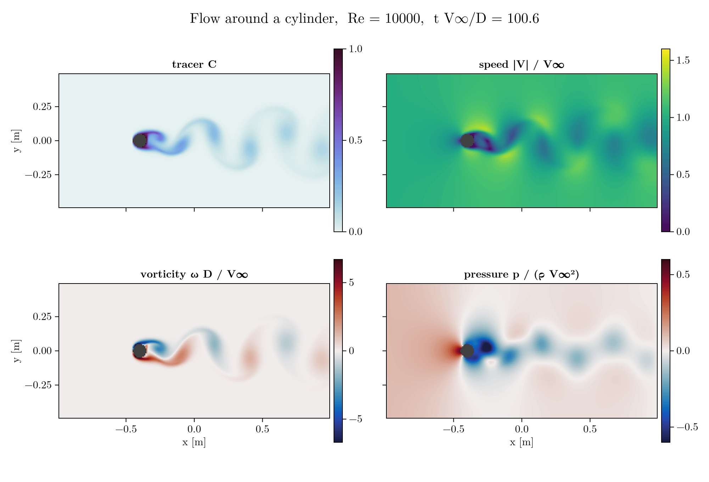
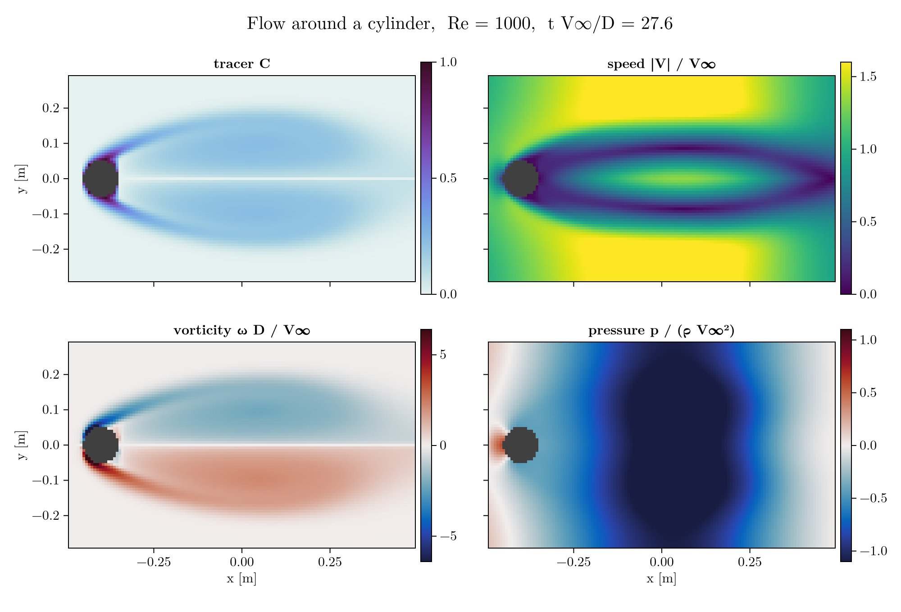

# NavierStokes3D

[](https://github.com/mattbuergler/NavierStokes3D/actions/workflows/CI.yml)

A parallel solver for the incompressible 3D Navier–Stokes equations, written in Julia. The same code runs on multi-core CPUs, on a single GPU, and on many GPUs through MPI:

- [ParallelStencil.jl](https://github.com/omlins/ParallelStencil.jl) provides architecture-agnostic stencil kernels (threads or CUDA).
- [ImplicitGlobalGrid.jl](https://github.com/eth-cscs/ImplicitGlobalGrid.jl) handles the domain decomposition and halo exchange.

It started as a project for a course on solving PDEs in parallel on GPUs, and was inspired by [NavierStokes.jl](https://github.com/utkinis/NavierStokes.jl). The main contribution is the extension to 3D and to multiple GPUs.



*Flow around a cylinder at Re = 10 000 on a 254 × 127 × 51 grid (horizontal mid-plane), $t V_\infty/D = 100$ to $148$. Tracer, speed, vorticity and pressure.*

## Contents

1. [Mathematical model](#mathematical-model)
2. [Numerical method](#numerical-method)
3. [Usage](#usage)
4. [Test case](#test-case)
5. [Validation](#validation)
6. [Tests](#tests)
7. [Limitations](#limitations)

## Mathematical model

The incompressible Navier–Stokes equations are

$$\frac{\partial \boldsymbol{u}}{\partial t} + (\boldsymbol{u}\cdot\nabla)\boldsymbol{u} = -\frac{1}{\rho}\nabla p + \frac{1}{\rho}\nabla\cdot\boldsymbol{\tau} + \boldsymbol{g}, \qquad \nabla\cdot\boldsymbol{u} = 0,$$

with velocity $\boldsymbol{u}$, pressure $p$, density $\rho$, viscous stress $\boldsymbol{\tau}$ (dynamic viscosity $\mu$) and gravity $\boldsymbol{g}$. A passive tracer $C$ is advected with the flow.

## Numerical method

All fields live on a staggered (MAC) grid: pressure, tracer and normal stresses at cell centres, velocity components at cell faces. Each time step is a fractional step in the spirit of Chorin's projection method:

1. **Prediction.** An intermediate velocity $\boldsymbol{u}^{\ast}$ accounts for viscous stresses and gravity:
   $\boldsymbol{u}^{\ast} = \boldsymbol{u}^{n} + \frac{\Delta t}{\rho}\nabla\cdot\boldsymbol{\tau}^n + \Delta t\ \boldsymbol{g}$.
2. **Pressure.** Requiring $\nabla\cdot\boldsymbol{u}^{n+1}=0$ gives a Poisson equation,
   $\nabla^2 p^{n+1} = \frac{\rho}{\Delta t}\nabla\cdot\boldsymbol{u}^{\ast}$,
   which is solved with an accelerated *pseudo-transient* method: a damped wave equation in pseudo-time is iterated until the scaled residual falls below a tolerance. Only local stencils are needed, so the solver scales well on GPUs.
3. **Projection.** $\boldsymbol{u}^{\ast\ast} = \boldsymbol{u}^{\ast} - \frac{\Delta t}{\rho}\nabla p^{n+1}$.
4. **Advection.** Velocity and tracer are advected with the semi-Lagrangian method of characteristics and tri-linear interpolation.

The cylinder is an immersed no-slip obstacle (velocity set to zero inside). Boundaries: fixed velocity at the inlet, fixed pressure at the outlet, zero gradient elsewhere.

Because the pseudo-transient iterations and the advection both use only neighbouring cells, the multi-rank result is identical to the single-rank result up to round-off. This is checked by the test suite. For this to hold, a departure point may not move farther than the one-cell halo, which limits the advective CFL number (see `CFL_adv`).

## Usage

### Installation

```bash
git clone https://github.com/mattbuergler/NavierStokes3D.git
cd NavierStokes3D
julia --project -e 'using Pkg; Pkg.instantiate()'
```

### Running

```bash
# multi-threaded CPU (nx = cells per rank, nt = time steps, output directory, output every nout steps)
julia --project -t auto -O3 --check-bounds=no scripts/run.jl 127 500 out 10

# single GPU
NS3D_USE_GPU=true julia --project -O3 --check-bounds=no scripts/run.jl 255 1000 out 10

# several GPUs / ranks (one rank per GPU; use a CUDA-aware MPI where available)
mpiexec -n 4 julia --project -O3 --check-bounds=no scripts/run.jl 255 1000 out 10
```

`scripts/run_slurm.sh` is an example job script for a GPU cluster. From Julia:

```julia
using NavierStokes3D
res = run_navierstokes3D(nx=63, nt=100, Re=1000.0, do_save=true, outdir="out")
res.fields.Vx          # gathered cell-centred field on rank 0
```

`scripts/run.jl` only exposes the grid size, number of steps and output settings. The geometry and the Reynolds number are keyword arguments of `run_navierstokes3D`: `lx` (domain length, m), `ly_lx` and `lz_lx` (width and span as fractions of `lx`), `D` (cylinder diameter, m), `x_cyl` (cylinder axis position, measured from the domain centre, m), `Re`, and `perturb` (amplitude of a small initial disturbance in the wake that breaks the symmetry, in units of the inflow velocity). The case shown below is

```julia
run_navierstokes3D(nx=256, ny=129, nz=53, lx=2.0, ly_lx=0.5, lz_lx=0.2, D=0.1, x_cyl=-0.4,
                   Re=1e4, perturb=0.05, nt=3800, nout=25, do_save=true, outdir="out")
```

The backend (`NS3D_USE_GPU`) is selected when the package is loaded. `nx` is the local size per rank including the two halo cells; the global size follows from the number of ranks.

### Visualisation

The solver writes raw `Float32` fields plus a `meta.toml` to the output directory. Plotting is a separate step with its own environment, so that it can run on a different machine than the solver:

```bash
julia --project=scripts -e 'using Pkg; Pkg.instantiate()'
julia --project=scripts scripts/visualize.jl out docs [stride] [framerate] [t_start]
```

This creates `docs/snapshot.png` (last frame) and `docs/flow.gif` (every `stride`-th frame from time `t_start` (in $D/V_\infty$, default 0) on, `framerate` frames per second; defaults 1, 8): tracer, speed, vorticity and pressure in the horizontal mid-plane, with a fixed colour scale and the cylinder masked. The flow is uniform along the cylinder axis, so this plane contains all of the structure.

### Strouhal number

```bash
julia --project=scripts scripts/strouhal.jl out [x_D] [y_D] [t_start]
```

Takes the dominant frequency $f$ of $V_y$ at a probe in the wake ($x_D$ diameters behind the cylinder, $y_D$ off the axis; defaults 5 and 0.5) after `t_start` (in $D/V_\infty$, default 40); $St = fD/V_\infty$. Choose `nout` so that a shedding period has at least about five frames.

## Test case

Flow past a cylinder ($D = 0.1$ m, axis along $z$) in a $2 \times 1 \times 0.4$ m channel ($20D \times 10D \times 4D$), $V_\infty = 1$ m/s, $\rho = 1000$ kg/m³, $Re = 10\,000$. The axis is $6D$ behind the inlet. Grid $254 \times 127 \times 51$ ($D \approx 12.7$ cells), 3800 time steps ($t V_\infty/D \approx 150$), a small initial disturbance in the wake (`perturb=0.05`). About 1 h 20 min on one Tesla P100.



A von Kármán vortex street forms and leaves through the outlet, with $St \approx 0.17$ (from `scripts/strouhal.jl`, probes $3D$ to $7D$ behind the cylinder, resolution about $0.01$). Not tested: shedding without the disturbance, and the drag of this case. Blockage is $10\,\%$. Earlier runs with the cylinder $1D$ behind the inlet and $t V_\infty/D \approx 28$ showed a steady wake; they were too short and too confined to be conclusive.

## Validation

Flow past a cylinder in a nearly unbounded domain (`scripts/benchmark.jl`: $30D \times 16D$, $6\,\%$ blockage, $16$ cells per $D$, 2D), compared with the published values collected in Table 1 of [arXiv:1803.09380](https://arxiv.org/abs/1803.09380) ($40$ cells per $D$).

| | this solver | literature |
|---|---|---|
| **Re = 40**: $C_d$, control volume | 1.73 – 1.76 | 1.54 – 1.66 |
| $C_d$, surface integral | 1.38 – 1.62 | |
| $C_d$, solver momentum exchange | 1.22 | |
| recirculation length $L_w/D$ | 2.17 | 2.21 – 2.55 |
| **Re = 100**: $St$ | 0.142 | 0.166 – 0.172 |
| mean $C_d$, control volume | 1.54 | 1.38 – 1.43 |
| mean $C_d$, surface integral | 1.28 – 1.39 | |
| mean $C_d$, solver momentum exchange | 1.04 | |
| $C_l$ amplitude, surface integral | 0.19 – 0.20 | 0.32 – 0.37 |

The solver does not reproduce the Re = 100 benchmark at this resolution: $St$ is 15 % low and the lift amplitude about half. A convergence study with more cells per $D$ has not been done.

The three drag estimates differ by up to 30 %:
- `force_cv.jl`: momentum balance on a box around the cylinder (insensitive to the box size, but includes the momentum loss of the advection scheme).
- `force_surface.jl`: pressure and wall shear on the staircase surface (the viscous part depends on the assumed wall distance of 0.5 to 1 cell, hence the ranges).
- The solver's own force (`forces.csv`): momentum removed inside the cylinder. It underestimates the drag because the semi-Lagrangian advection also removes momentum near the body; use it for time dependence only.

```bash
NS3D_USE_GPU=true julia --project -O3 --check-bounds=no scripts/benchmark.jl 100 16 200 out_bench 50
julia scripts/forces.jl out_bench 100
julia --project=scripts scripts/force_surface.jl out_bench 100 [wall_dist]
julia --project=scripts scripts/force_cv.jl out_bench 100
```

The arguments of `benchmark.jl` are Re, cells per $D$, end time in $D/V_\infty$, output directory and output interval in steps.

## Tests

```bash
julia --project -e 'using Pkg; Pkg.test()'
```

The suite covers the interpolation kernel (exact for linear fields), a short end-to-end run (finite, bounded, converged pressure solver, output files) and the consistency of the results between 1 and 2 MPI ranks. It runs on the CPU in continuous integration.

## Limitations

- Low-order scheme: first-order explicit Euler in time, semi-Lagrangian advection with linear interpolation. This is numerically diffusive; there is no turbulence model.
- The explicit time step is limited by advection (`CFL_adv = 0.5`) and diffusion.
- The cylinder is a staircase (voxelised) immersed boundary, not boundary-fitted.
- Drag and lift: the three available estimates disagree by up to about 30 % (see [Validation](#validation)); a conservative momentum scheme would make the solver's own force reliable.
- Output is gathered on rank 0, which limits the largest case that can be written.
- The pressure solver dominates the run time; a multigrid or FFT-based solver would be faster at high resolution.
