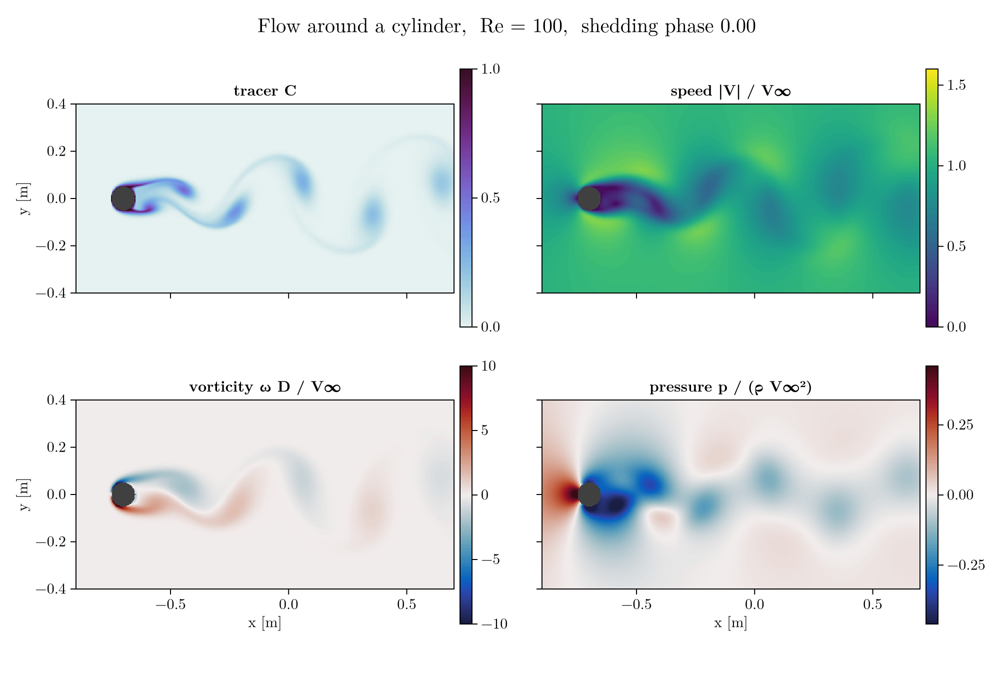

# Cylinder at Re = 100, resolution study

Flow past a circular cylinder at 16 and 32 cells per diameter, compared with the published values collected in Table 1 of [arXiv:1803.09380](https://arxiv.org/abs/1803.09380) (40 cells per $D$).



*One shedding period at 32 cells per $D$, cropped to the near wake. The loop is built from solver frames between $t V_\infty/D = 100$ and $150$, ordered by shedding phase instead of time.*

## Setup

Defined by `scripts/benchmark.jl`:

- Domain $30D \times 16D$ (blockage 6 %), cylinder axis $8D$ behind the inlet, uniform inflow, $D = 0.1$ m, $V_\infty = 1$ m/s, $\rho = 1000$ kg/m³.
- Thin span of 6 cells, so the flow is two-dimensional.
- Time step $0.5\,h / V_\infty$, where $h$ is the cell size.
- Disturbance `perturb = 0.05`, added so that the shedding starts.

| Case | Cells per $D$ | Grid | Steps | End time ($D/V_\infty$) | Frame interval (steps) | Time on Tesla P100 |
|---|---|---|---|---|---|---|
| `n16` | 16 | 480 × 256 × 6 | 6400 | 199.2 | 50 | about 2.4 h |
| `n32` | 32 | 960 × 512 × 6 | 9600 | 149.7 | 100 | about 19.4 h |

Both cases have a frame about every $1.56\,D/V_\infty$.

```bash
CUDA_DEVICE_ORDER=PCI_BUS_ID CUDA_VISIBLE_DEVICES=<gpu> testcases/cylinder_re100/run.sh n32   # or n16
testcases/cylinder_re100/analyse.sh testcases/cylinder_re100/rerun/n32
julia --project=scripts scripts/visualize.jl testcases/cylinder_re100/rerun/n32 testcases/cylinder_re100/figures 1 16 100 "-2,14,4" 6.4818
```

The last argument is the shedding period of `n32` in $D/V_\infty$, measured from the zero crossings of the lift after $t = 100$. All six measured periods are 6.482.

Set `JULIA` if `julia` is not on the path. `run.sh` writes to `rerun/` (gitignored), not to the stored results.

## Results

Statistics are taken after $t = 100\,D/V_\infty$, when the lift and drag are periodic. The full output is in `results/*/analysis.txt`.

| | 16 per $D$ | 32 per $D$ | Literature |
|---|---|---|---|
| $St$ | 0.142 | 0.154 | 0.166 – 0.172 |
| $C_l$ amplitude, surface integral (wall distance 0.5 cells) | 0.203 | 0.290 | 0.32 – 0.37 |
| $C_l$ amplitude, surface integral (wall distance 1 cell) | 0.193 | 0.269 | 0.32 – 0.37 |
| $C_l$ amplitude, solver momentum exchange | 0.151 | 0.207 | 0.32 – 0.37 |
| Mean $C_d$, control volume | 1.54 | 1.50 | 1.38 – 1.43 |
| Mean $C_d$, surface integral (wall distance 0.5 cells) | 1.39 | 1.48 | 1.38 – 1.43 |
| Mean $C_d$, surface integral (wall distance 1 cell) | 1.28 | 1.31 | 1.38 – 1.43 |
| Mean $C_d$, solver momentum exchange | 1.04 | 1.05 | 1.38 – 1.43 |

- **$St$ and lift:** both move towards the literature when the resolution is doubled, which suggests that numerical diffusion is the main cause of the mismatch. First-order extrapolation from these two points gives $St \approx 0.166$ and a surface-integral $C_l$ amplitude of 0.35 – 0.38. The convergence order has not been measured, because that needs a third resolution.
- **Drag:** not settled. The estimates span 1.31 – 1.50 at 32 per $D$, and the viscous part of the surface integral is inversely proportional to the assumed wall distance.
- **Solver force:** its drag does not change with resolution, so it should not be used for absolute values.

## Limitations

- The surface-integral lift comes from about 4 frames per shedding period, so its amplitude may read slightly low.
- The lift from `force_cv.jl` is not used. Its peaks of about ±2 are roughly 10 times the surface-integral values.
- The two cases use different averaging windows (to $t = 199$ and $t = 150$). In 10 $D/V_\infty$ windows, the solver-force lift amplitude stays constant to four decimals and the mean drag varies by at most 0.0004, from $t = 110$ on in `n32` and from $t = 120$ on in `n16`.
- The disturbance was not varied, so shedding without it is untested.

## Files

- `results/n*/forces.csv`: solver force at every time step.
- `results/n*/meta.toml`: grid, parameters and frame times.
- `results/n*/analysis.txt`, `run.log`: output of `analyse.sh` and of the run.
- `figures/`: rendered from `n32`. The GIF is one period from 26 frames; the snapshot is the last frame, at $t = 149.7$.
- `results/n*/*.bin`: raw frames (7.2 GB in total), not committed. `forces.jl` works without them; `force_surface.jl`, `force_cv.jl` and `visualize.jl` need them.

## Code version

`n32` ran the solver of commit `5c407f6`. `n16` ran before that commit, and the only later change to `src/solver.jl` is a docstring. Rerunning the first 100 steps of `n16` with `5c407f6` reproduces the stored force history exactly.
